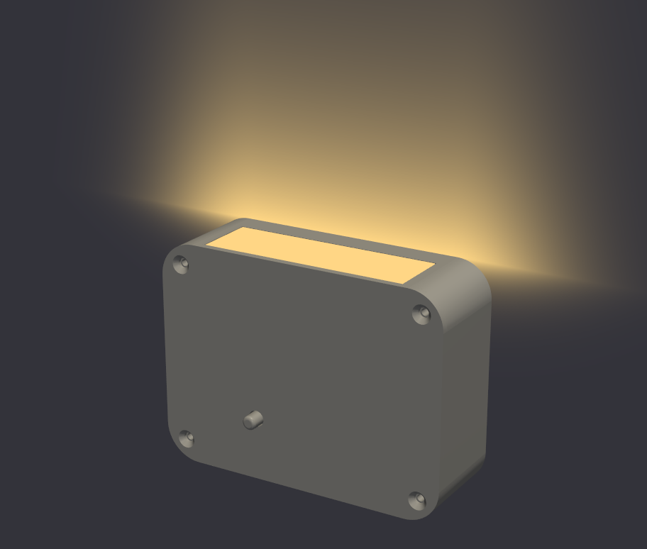
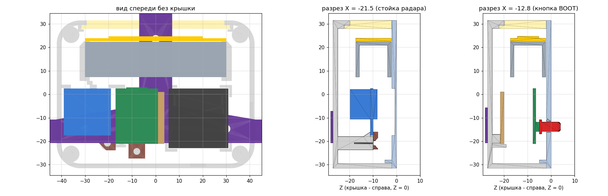
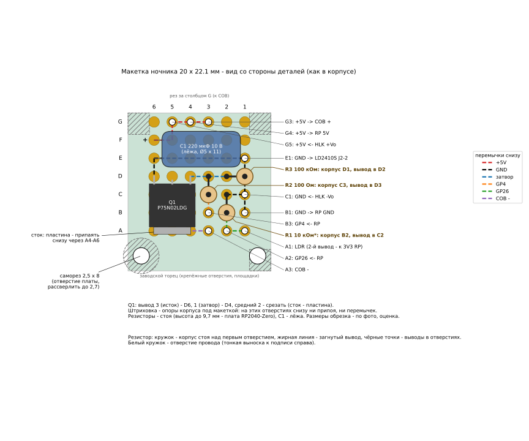
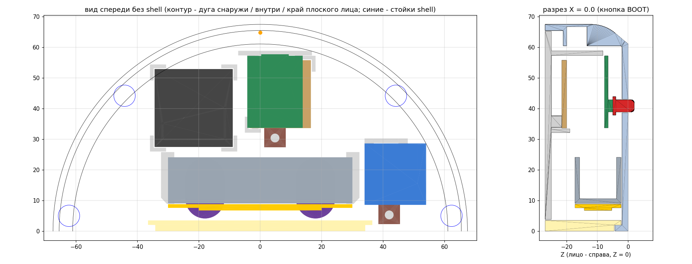

# Автоматическая лампа в ванной

Лампа включается по датчику движения и гаснет, когда движения нет. Экрана нет. Два варианта: лампа 230 В
(ключ на оптосимисторе) и светодиодный ночник в корпусе прибора.

Ночник на стене - вид модели корпуса (84 × 63 × 27 мм) с горящим COB: свет выходит вверх через рассеиватель и
ложится на стену (`Scripts/render_view.py`, корпус - `Scripts/enclosure.py`).

**Состояние:** прошивка для RP2040-Zero (калибровка и работа) - собирается, на железе не проверена; блок питания
рассчитан, на железе не проверен; силовая часть (симистор лампы) не спроектирована. Ночник: схема и прошивка
(яркость кнопкой) готовы, на железе не проверены.

<!-- toc -->

**Оглавление**

- [Как работает](#как-работает)
  - [Залипание](#залипание)
- [Железо](#железо)
- [Распиновка](#распиновка)
  - [Схема соединений](#схема-соединений)
  - [Блок питания](#блок-питания)
  - [Ночник](#ночник)
- [Калибровка](#калибровка)
  - [Настройка задержки выключения](#настройка-задержки-выключения)
  - [Настройка частоты ШИМ ночника](#настройка-частоты-шим-ночника)
  - [Дежурная подсветка ночника](#дежурная-подсветка-ночника)
  - [Настройка по USB](#настройка-по-usb)
- [Прошивка](#прошивка)
  - [Проверка на ПК (симулятор)](#проверка-на-пк-симулятор)
- [Корпус](#корпус)
  - [Корпус «полукруг»](#корпус-полукруг)
- [Лицензия](#лицензия)

<!-- /toc -->

---

## Как работает

Две рабочие прошивки (окружения PlatformIO): `rp2040zero` - лампа 230 В, `rp2040zero_night` - ночник. Логика
общая, отличия - в таблице ниже. Все времена - константы `Firmware/src/config.h`.

**Включение и выключение.**

* МК просыпается каждые 20 мс (`TICK_MS`), опрашивает кнопку BOOT и выход присутствия датчика OT2 и снова засыпает.
* Человек появился (OT2 = 1) - МК меряет свет фоторезистором. Темно (ниже порога) - лампа включается. Скорость
  отклика датчика - «быстрая» (`SENSOR_RESPONSE_SPEED`, табл. 2-2 протокола; с заводской «обычной» лампа
  загоралась через 1-1,5 с после входа), записывается в датчик вместе с задержкой.
* Светло - лампа не горит, свет перемеряется раз в 5 с (`LIGHT_RECHECK_MS`), пока человек в комнате. Стемнело
  или выключили свет - лампа загорится в пределах 5 с.
* Лампа горит - свет больше не меряется (фоторезистор видит саму лампу): лампа горит, пока датчик видит человека.
* Человек ушёл: датчик держит OT2 = 1 ещё время задержки после последнего обнаружения (по умолчанию 30 с,
  `OFF_DELAY_S`; настраивается кнопкой или по USB, 10-120 с), затем OT2 = 0 - лампа сразу гаснет. Задержка
  записывается в датчик при каждом включении, после калибровки и после настройки.

**Включение питания.**

1. Замкнута перемычка GP7 - GP8 - индикатор горит синим, [консоль настройки](#настройка-по-usb) по USB; выход -
   командой `exit` или через 1 мин без команд (от включения или от последней команды). Перемычки нет - сразу дальше.
2. При `LOW_POWER 1` (`config.h`) USB выключается и такты переходят на 12 МГц от кварца; при `LOW_POWER 0`
   (сейчас) такты и USB остаются по умолчанию. Индикатор вспыхивает зелёным 0,3 с, настройки записываются в датчик,
   начинается работа.

Калибровки в памяти нет (первое включение или новый формат калибровки после обновления прошивки) - прибор работает
по умолчанию: пороги и дальность датчика заводские, задержка 30 с, порог света - середина шкалы АЦП.

Свет гаснет не сразу по OT2 = 0, а через `minon` секунд (по умолчанию 30, `MIN_ON_DEFAULT_S`) от последнего
опроса с OT2 = 1: короткие провалы и дребезг выхода датчика не мигают светом.

### Залипание

Предмет рядом с датчиком (например, большая банка) может держать «человек есть» постоянно - свет не гаснет. Признак
залипания: лампа горит без перерыва `stuck` минут (по умолчанию 60) и всё это время свет не меняется - замер раз в
10 с остаётся в полосе ± `stuckpct` % (по умолчанию 1 %) от разницы «светло - темно», которую запомнила калибровка.
Свет вышел из полосы (включили или выключили свет в ванной) - отсчёт заново. Без фоторезистора (`ldr 0`), без
калибровки света или при `stuckpct 0` - только по времени.

Тогда лампа гаснет, индикатор начинает мигать белым (вспышка 0,1 с раз в 3 с), а датчик переводится в стандартный
отчёт (энергия каждых ворот по UART). Первые 3 с прошивка запоминает фон - максимум энергии каждых ворот вместе с
предметом. Дальше лампа включается (если темно), когда энергия любых ворот выше своего фона на `stuckdb` дБ (по
умолчанию 3 - энергия в 2 раза выше пика фона; подобрать на месте по `mon`), и гаснет через `minon` секунд после
последнего превышения. Обычная работа
возвращается, когда OT2 = 0 (датчик перестал видеть «человека» - предмет убрали) или после калибровки. Не проверено
на железе: насколько энергия от человека выше фона с предметом, данных нет.

**Кнопка BOOT.**

| Нажатие | Что делает |
|---|---|
| короткое (до 5 с) | лампа 230 В: не горит - включить, как по датчику (горит `minon` секунд, дальше - пока датчик видит человека; свет не проверяется), горит - продлить на `minon`. Ночник: основной свет не горит - [дежурная подсветка](#дежурная-подсветка-ночника) выкл / 1 / 3 / 5 % по кругу (запоминается), горит - следующий уровень яркости (запоминается) |
| удержание 5 с | синяя вспышка; отпустить до 10 с - [настройка задержки выключения](#настройка-задержки-выключения) |
| удержание 10 с | индикатор начинает мигать красным / зелёным - калибровка (см. [Калибровка](#калибровка)), не дожидаясь отпускания; из любого режима, повторное удержание начинает её заново. Исключение - ночник в настройке задержки: удержание 10 с - [настройка частоты ШИМ](#настройка-частоты-шим-ночника) (зелёный) |

Длительность калибровки: 12 с выйти из комнаты (отсчёт - с начала мигания, кнопку сразу отпустить), шаг 1 - 125 с (сканирование датчика 120 с - меньше программа
производителя не допускает; на деле 100 % через 123 с), пауза 5 с и чтение порогов, шаг 2 - 30 с; итого около
2 мин 52 с. После 100 % датчик несколько секунд не отвечает (на железе - около 8-9 с) и теряет команды, поэтому пороги
шага 1 читаются через 5 с после шага 1, при неудаче - повтор раз в 1 с, до 10 попыток; шаг 2 (лампа, зелёный) -
только после этого.

**Индикатор WS2812B на плате.**

| Индикатор | Значение |
|---|---|
| зелёная вспышка 0,3 с | включение: прошивка запустилась (повторяется сама - МК перезапускается) |
| не горит | обычная работа |
| красный / зелёный по очереди (по 0,4 с) | калибровка, шаг 0: выйти из комнаты |
| красный | калибровка, шаг 1; на последние 10 с шага гаснет - замер света (ночник с фоторезистором - на последние 25 с: «темно» и с дежурной подсветкой на каждом уровне) |
| зелёный | калибровка, шаг 2; на последние 10 с шага гаснет - замер света |
| одна синяя вспышка | кнопка удерживается 5 с: отпустить - настройка задержки |
| синие вспышки по счёту, пауза 3 с | настройка задержки: число вспышек = десятки секунд |
| синий постоянно | включение с перемычкой GP7 - GP8: [настройка по USB](#настройка-по-usb) |
| красный, синий, зелёный по 0,4 с | калибровка успешна; затем обычная работа |
| 5 вспышек красным по 0,2 с | ошибка калибровки; затем обычная работа |
| мигает красным 0,4 / 0,4 с, постоянно | нет связи с датчиком: не принял настройки за 3 попытки с паузой 10 с (при включении, после настройки задержки или ошибки калибровки). Без связи лампа надёжно работать не будет - проверить подключение датчика. Мигание снимается успешной записью в датчик (настройка задержки, калибровка) или новым включением |
| часто мигает красным 0,15 / 0,15 с, постоянно | лампа 230 В: оборван стабилитрон D1 блока питания; лампа работает как обычно |
| белая вспышка 0,1 с раз в 3 с | [залипание](#залипание) датчика: лампа - по энергии ворот; до OT2 = 0 или калибровки |

**Отличия вариантов.**

| | `rp2040zero` - лампа 230 В | `rp2040zero_night` - ночник |
|---|---|---|
| Выход GP4 | 1 - горит (MOC3043M -> симистор) | ШИМ 3,5 кГц (`pwm`) на затвор P75N02LDG |
| Яркость | полная | 5 уровней, по умолчанию 5, 10, 20, 35, 60 % (проценты - настройка по USB, `pct`) - короткое нажатие BOOT, пока ночник горит, по кругу; хранится во флеш-памяти, после первой калибровки - 20 %. Основной свет не горит - короткое нажатие переключает [дежурную подсветку](#дежурная-подсветка-ночника) |
| Калибровка, шаг 2 | лампа горит сама - фоторезистор запоминает её свет | ночник горит - сигнал «войти»; свет в ванной включает человек, на последние 10 с (замер) ночник гаснет; при включённом свете ночник потом не загорается |
| Контроль | напряжение блока питания раз в минуту (выше 4,55 В - обрыв D1, индикатор) | температура МК раз в 10 с: ночник горит и выше порога (по умолчанию 55 °C, настройка по USB `tmax`, с поправкой `NIGHT_TEMP_OFFSET_C`) - яркость на 1/3 меньше, не чаще раза в 2 мин, до уровня 0; остыл на 5 °C ниже порога - яркость обратно теми же шагами |
| Сон МК между опросами (`LOW_POWER 1`; при 0 - всегда без остановки тактов) | SLEEP (такты остановлены) | пока ШИМ идёт - без остановки тактов (иначе ШИМ встанет) |

## Железо

* **Датчик присутствия - HLK-LD2410S** (радар 24 ГГц, малое потребление). Протокол:
  `Docs/HLK-LD2410S_Serial_communication_protocol_V1.00.pdf`.
  * Питание 3,3 В (3,0-3,6 В); выход присутствия OT2 и UART - 3,3 В (табл. 1-2); UART по умолчанию 115200, 8N1.
  * 16 ворот дальности; дальние ворота 1-16, ближние 0-16; время «нет человека» 10-120 с (табл. 2-2).
    Размер ворот в протоколе не указан.
  * Пороги срабатывания и удержания по каждым воротам (п. 2.2.10, 2.2.12); автоматический подбор порогов по фону
    (п. 2.2.9).
  * Сохраняются ли настройки при выключении питания - в протоколе не сказано (проверить на макете).
  * Средний ток - около 0,1 мА при выдаче 1 раз в секунду (данные продавцов, не протокол).
  * За модулем - металлический экран (ослабить приём со стороны кухни); при бестрансформаторном питании экран под
    фазой - только внутри корпуса, изолирован.
* **Датчик освещённости - фоторезистор:** на свету лампа не включается.
* **Микроконтроллер - Waveshare RP2040-Zero** (`Docs/RP2040-Zero.pdf`): 18 × 23,5 мм, прошивка по USB-C (UF2),
  20 GPIO по краю, 2 UART (UART0 - GP0/GP1, UART1 - GP4/GP5 и др.), RGB-светодиод WS2812 на GP16 (распиновка -
  стр. 1-2). Даташит RP2040 - `Docs/rp2040-datasheet.pdf`.
  * Схема - `Docs/RP2040-Zero_Schematic.pdf`: вывод 5V (P1-23, цепь VSYS) соединён с VBUS разъёма USB-C **напрямую,
    без диода**; 3,3 В - стабилизатор RT9013-33 (U1) от VSYS; кварц 12 МГц.
  * Потребление RP2040 (ток DVDD, типично): SLEEP 0,39 мА, DORMANT 0,18 мА (табл. 637 даташита).
  * Замер платы целиком (питание 3,3 В на вывод 3V3, USB отключён; скетч `Tests/RP2040`), 2026-10-28:

    | Прошивка | WS2812B выкл | 50 % | 100 % |
    |---|---|---|---|
    | Ядро по умолчанию, USB, цикл без сна | 31,3 мА | 36,7 мА | 41,6 мА |
    | 12 МГц от кварца, PLL выкл, без USB, сон WFE | 7,8 мА | 11,7 мА | 15,0 мА |
    | То же + SLEEP (такты кроме таймера выкл), ядро 1,05 В | 6,5 мА | 10,5 мА | 13,96 мА |
    | Кнопка RESET зажата (RP2040 в сбросе) | 5,74 мА | - | - |

    Для сравнения: другая плата на RP2040 (фиолетовый клон без WS2812B и светодиода питания, та же прошивка
    со SLEEP) - 6,2 мА. Значит, WS2812B в покое берёт не больше примерно 0,3 мА, а основной ток - общий для
    плат на RP2040 при питании 3,3 В на вывод 3V3.
    При питании 5 В на вывод 5V (через стабилизатор платы, как в итоговой схеме) RP2040-Zero со SLEEP - 6,3 мА:
    обратное питание стабилизатора на результат не влияет. Итог: около 6,3 мА - предел платы RP2040-Zero.

    WS2812B берёт примерно 40 % от тока по даташиту V5: питание 3,3 В ниже допустимых для V5 3,7 В.
  * МК сам запускает автокалибровку порогов LD2410S по UART (115200).
  * Тактирование: системная частота - от кварца 12 МГц без PLL (ток ядра около 5 мА при полной нагрузке обоих ядер
    по рис. 172 даташита; на 125 МГц - около 28 мА). АЦП требует ровно 48 МГц (п. 4.9.2, табл. тактов на стр. 184):
    на время замера фоторезистора включается PLL_USB, после замера выключается. UART 115200 от 12 МГц - дробный
    делитель.
  * Рассматривались и отклонены: ATtiny13A (нет аппаратного UART), ATmega328P (на 8 МГц ошибка UART -3,5 % при
    допуске приёмника ±1,5-2 %, прошивка программатором; `Docs/ATmega328P_Datasheet_DS40002061B.pdf`),
    AVR64DD28 (дорог и малодоступен).
* **Калибровка датчика и фоторезистора:** долгим нажатием кнопки BOOT (например, после
  перестановки в ванной: поставили или убрали стиральную машину) - см. [Калибровка](#калибровка). Без калибровки
  (первое включение) - настройки по умолчанию: датчик с заводскими порогами, порог света - середина шкалы АЦП.
* Лампа 230 В. Питание - бестрансформаторное (конденсаторное) от сети: вся схема без гальванической развязки;
  прошивка по USB - только при отключённой сети. Блок отдаёт постоянный ток - рассчитывается по пиковому
  потреблению (лампа включена, светодиод оптосимистора горит), см. [Блок питания](#блок-питания).
* Ключ лампы: оптосимистор - предложен MOC3043M (светодиод прямо с вывода МК, см. [Схема соединений](#схема-соединений));
  не выбраны: силовой симистор, снаббер.
* Вариант «ночник»: блок питания HLK-5LD05 (5 В, с развязкой), COB-пластина 5 В 2 Вт через P75N02LDG, яркость - ШИМ,
  уровень - коротким нажатием BOOT, см. [Ночник](#ночник).

Условия: ванная около 3 м², датчик висит на гипсовой стене 4 см, за ней сразу кухня - движение на кухне не должно
включать лампу.

## Распиновка

Waveshare RP2040-Zero (эталон - `Docs/RP2040-Zero_Schematic.pdf`). ESP32-C3 / ESP32-C6 - будут добавлены.

| Вывод RP2040-Zero | Куда | Назначение |
|---|---|---|
| GP0 (UART0 TX) | LD2410S J2-4 (RX) | команды датчику, 115200 8N1; при закрытом UART - подтяжка к 3V3 (иначе на RX датчика 0 - «обрыв линии», и датчик несколько секунд молчит) |
| GP1 (UART0 RX) | LD2410S J2-3 (OT1, TX) | ответы и отчёты датчика (внутренняя подтяжка к 3V3, как у адаптера USB-UART) |
| GP2 | LD2410S J2-5 (OT2) | 1 - человек есть (внутренняя подтяжка к GND: без датчика - «никого») |
| GP4 | лампа 230 В: R2 180 Ом -> MOC3043M вывод 1 (анод); ночник: R2 100 Ом -> затвор Q1 P75N02LDG | лампа: 1 - горит; ночник: ШИМ 3,5 кГц (`pwm`), 0-100 %; ток вывода настроен на 12 мА |
| GP26 (ADC0) | средняя точка делителя LDR / R1 | освещённость |
| GP28 (ADC2) | средняя точка делителя R5 / R6 (C3) с узла стабилитронов | контроль обрыва стабилитрона D1 (только лампа 230 В) |
| GP16 | WS2812B на плате | индикатор калибровки и обрыва D1 |
| GP7 - GP8 | перемычка между собой (угол платы) | замкнута при включении - консоль настройки по USB; при проверке GP8 = 0, GP7 - вход с подтяжкой к 3V3, затем оба - входы с подтяжкой к GND |
| BOOT (кнопка на плате) | - | удержание 10 с - калибровка; 5 с - настройка задержки выключения (в ней удержание 10 с у ночника - настройка частоты ШИМ); короткое - лампа 230 В: включить, как по датчику; ночник: не горит - дежурная подсветка по кругу, горит - следующий уровень яркости |
| 3V3 | LD2410S J2-1 (3V3), верх LDR | **общее питание 3,3 В** RP2040 и LD2410S (выход стабилизатора платы RT9013) |
| 5V (VSYS) | лампа 230 В: блок питания через D3 (около 3,4-4,2 В); ночник: +5 В HLK-5LD05 | вход стабилизатора платы |
| GND | LD2410S J2-2, R1, MOC3043M вывод 2 (катод), минус блока питания | **общая земля всех узлов** |

Логические уровни: LD2410S - 3,3 В (табл. 1-2 протокола), RP2040 - 3,3 В: соединяются напрямую.

### Схема соединений

Схема строится скриптом `Scripts/schematic.py` (schemdraw 0.23).

Внешние элементы:

| Обозн. | Номинал | Назначение |
|---|---|---|
| R1 | 10 кОм* | нижнее плечо делителя фоторезистора (GP26 - GND); *подобрать под фоторезистор: примерно равно его сопротивлению при пороговой освещённости. Направление (больше света - больше или меньше отсчёт) калибровка определяет сама |
| R2 | 180 Ом | ток светодиода U3 прямо с вывода GP4 (12 мА): худший случай (2,62 В - 1,5 В) / 180 Ом = 6,2 мА - больше тока срабатывания 5 мА; лучший - около 12 мА |
| J1 | перемычка (проводок, капля припоя или джампер) | GP7 - GP8 RP2040-Zero, соседние выводы в правом нижнем углу платы: замкнута при включении - консоль настройки по USB (см. [Настройка по USB](#настройка-по-usb)); в работе разомкнута. Общая для лампы и ночника |
| U3 | MOC3043M (предложен) | оптосимистор с переходом через ноль: ток срабатывания светодиода не больше 5 мА, 400 В (`Docs/MOC304xM_datasheet.pdf`, табл. электрических характеристик; включение на 240 В - рис. 10). Выводы: 1 - анод, 2 - катод, 4 и 6 - выходы, 3 и 5 не подключать |

Транзистор не нужен: вывод RP2040 с настройкой 12 мА гарантирует не меньше 2,62 В (даташит RP2040, табл. GPIO,
стр. 616), а MOC3043M срабатывает от 5 мА. Сумма токов всех выводов RP2040 - не больше 50 мА. После сброса вывод -
вход с подтяжкой к земле: лампа выключена, пока прошивка не включит её.

\* - номинал уточняется после выбора детали. Силовая часть (симистор, снаббер) - после выбора лампы.

### Блок питания

Конденсаторный (бестрансформаторный): гасящий конденсатор C1 - мост BR1 - стабилитроны D1 (основной) и D2
(запасной) - диод D3 - вывод 5V платы. Стабилизатор платы RT9013-33 делает из этого общие 3,3 В для RP2040,
LD2410S и фоторезистора. Ток блока постоянный, лишнее уходит в стабилитрон.

| Обозн. | Номинал | Назначение |
|---|---|---|
| R3 | 15 Ом 1 Вт, невозгораемый (разрывной) | ограничивает бросок тока при включении: не больше 253 × 1,41 / 15 = 24 А на время около 10 мкс (15 Ом × C1), мосту допустимо 50 А на 8,3 мс; предохранитель при пробое C1 (около 17 А). Рассеивает 0,04 Вт при 253 В |
| C1 | 0,68 мкФ, X2 275 В~ | гасящий конденсатор: ток блока, см. расчёт ниже |
| R4 | 1 МОм (или 2 × 470 кОм последовательно, 0,25 Вт) | разряжает C1 после отключения от сети (0,68 с), 53 мВт |
| BR1 | 2W10 (1000 В, 2 А, корпус WOB под пайку в отверстия) | мост (`Docs/2W005-2W10_datasheet.pdf`) |
| D1 | 1N4731A (4,3 В ±5 %, 1,3 Вт) | основной стабилитрон, через него весь лишний ток (`Docs/1N4728A-1N4761A_Vishay.pdf`) |
| D2 | 1N4733A (5,1 В ±5 %, 1,3 Вт) | запасной: пока D1 цел, почти не проводит (не изнашивается); при обрыве D1 держит напряжение |
| C2 | 470 мкФ 16 В | сглаживание и запас на импульсы тока радара |
| D3 | 1N5819 (Шоттки, 40 В) | не пускает 5 В от USB в стабилитроны: на плате вывод 5V соединён с USB напрямую, а D1 на 4,3 В взял бы от USB сотни мА (`Docs/1N5817-1N5819_Vishay.pdf`) |
| R5 / R6 | 100 кОм / 150 кОм, 1 % | делитель напряжения стабилитронов на GP28 (ADC2): 5,36 В -> 3,22 В, ток 22 мкА |
| C3 | 100 нФ | фильтр входа АЦП (сопротивление делителя 60 кОм) |

Расчёт (сеть 230 В -10 % / +10 %, 50 Гц):

* Ток блока (выпрямленный, средний) = 0,9 × U × 2π × 50 × C1: **39,8 мА** при 207 В, 44,2 мА при 230 В, 48,6 мА при 253 В.
* Пиковое потребление (лампа включена, калибровка): плата RP2040-Zero без сна - 7,8 мА (замер), WS2812B на уровне
  калибровки - около 1,5 мА (оценка по замеру на 50 %), светодиод MOC3043M - до 11,4 мА ((3,3 - 1,25) / 180 Ом),
  делитель фоторезистора - до 0,33 мА, LD2410S - около 0,1 мА в среднем (данные продавцов). Итого около **21 мА**:
  запас 19 мА при 207 В - на неизвестный ток LD2410S в режиме калибровки (официальных данных о токе нет).
* Нагрев стабилитрона: худший случай - сеть 253 В, лампа выключена, МК спит (6,3 мА): D1 - (48,6 - 6,3) мА × 4,5 В
  = 0,19 Вт, D2 после обрыва D1 - 0,23 Вт (допустимо 1,3 Вт, нагрев не больше 0,23 × 110 К/Вт = 25 К). Отдельная
  нагрузка «чтобы не грелся стабилитрон» не нужна.
* Напряжение на выводе 5V - напряжение D1 минус D3 (около 0,3 В при 20 мА): не больше 4,2 В. Самое низкое - сеть
  207 В и лампа включена (через D1 около 19 мА): по оценке около 3,45 В. Стабилизатору RT9013 для 3,3 В на нашем токе
  почти не нужен запас (250 мВ при 500 мА), а если он немного недотянет, 3,1-3,3 В допустимы и для LD2410S
  (3,0-3,6 В), и для RP2040. Вход RT9013 2,2-5,5 В - по копиям даташита, оригинала в `Docs` нет.

**Контроль стабилитрона.** Пробой стабилитрона (короткое замыкание) безопасен: ток ограничен C1, плата просто без
питания. Опасен обрыв: блок отдаёт постоянный ток, и без стабилитрона напряжение растёт, пока не сгорят RT9013 и
плата. Поэтому D1 и D2 разные, и МК раз в минуту меряет их напряжение (GP28):

* D1 цел - не больше 4,38 В (4,52 В по даташиту при 58 мА, при нашем токе до 42 мА ниже на 16 мА × 9 Ом);
* D1 оборван, держит D2, лампа выключена (ток 33-42 мА) - не меньше 4,74 В (4,85 В при 49 мА минус 16 мА × 7 Ом);
  лампа включена (ток не меньше 19 мА) - не меньше 4,64 В: обрыв виден в любом замере;
* порог - середина, 4,55 В: запас около 0,17 В в обе стороны покрывает погрешность замера (опорное 3V3, резисторы 1 %).
  Пересчёт по дифференциальному сопротивлению ZZT - оценка: проверить замер в отладочной сборке.

Напряжение выше порога - индикатор постоянно мигает красным (0,15 с горит, 0,15 с не горит) до выключения питания;
лампа работает как обычно. Заменить D1, пока цел D2.

**Внимание:** блок питания без гальванической развязки - вся схема под фазой 230 В, включая металлический экран и
кнопку BOOT. USB к компьютеру подключать только при отключённой сети. Конденсатор C1 - только класса X2.

### Ночник

Второй вариант: вместо лампы 230 В - светодиодный ночник в корпусе прибора. Общее с лампой: МК, датчик,
фоторезистор, вывод GP4. Прошивка - окружение `rp2040zero_night`.

| Обозн. | Номинал | Назначение |
|---|---|---|
| F1 | T1A 250 В~ (с задержкой) | предохранитель на входе U4 - обязателен по даташиту HLK-5LD05 (гл. 6.1; допускается проволочный резистор 10 Ом) |
| RV1 | 10D561K | варистор от выбросов сети - обязателен по даташиту (гл. 6.1) |
| U4 | HLK-5LD05 | блок питания 5 В 1 А (`Docs/HLK-5LD05_5W-LD_datasheet_V1.0.pdf`): 25,4 × 25,4 × 19 мм, залит компаундом (IP65), развязка вход - выход 2500 В~ (гл. 7.2), без нагрузки меньше 0,1 Вт, 5,0 ± 0,2 В, пульсации до 100 мВ. Выводы: 1 - N, 2 - L, 4 - минус, 5 - плюс |
| C1 | 220 мкФ 10 В | на выходе U4 (гл. 6.2: 100-220 мкФ); сглаживает импульсы тока ШИМ |
| R2 | 100 Ом | в затвор Q1: ограничивает ток перезаряда затвора |
| R3 | 100 кОм | затвор - исток: Q1 закрыт, пока МК в сбросе или загрузчике |
| Q1 | P75N02LDG (TO-252 6,5 × 10 × 2,2 мм: 1 - затвор, 2 - сток, 3 - исток) | ключ ночника (`Docs/P75N02LDG.PDF`, Ver 1.1): 25 В, 10 мОм при 4,5 В (макс.); порог открывания 1-3 В (тип. 1,5 В). Сопротивление при 3,3 В в даташите не гарантировано; по типовым графикам (стр. 3) при 3-3,5 В канал держит 10-30 А - для 0,4 А с большим запасом. **Проверить на железе**: на 100 % падение сток - исток меньше 0,1 В, транзистор холодный. Затвор (стр. 2): Ciss 1840 пФ, Qgs 8,8 нКл, Qgd 19 нКл при 15 В (при 5 В - около 5 нКл); от GP4 3,3 В через R2 100 Ом фронт около 0,5 мкс, потери переключения 0,5 × 5 В × 0,4 А × 1 мкс × 3,5 кГц - около 3,5 мВт (на 50 кГц - 50 мВт), нагрева нет |
| J1 | перемычка | GP7 - GP8: настройка по USB, как у лампы (см. [Схема соединений](#схема-соединений)) |
| HL1 | COB 6015, 5 В 2 Вт, тёплый 2800-3200 К | светодиодная пластина 60 × 15 мм (светится 40 × 9 мм), 400 мА, больше 110 лм/Вт; ток задают резисторы 2,4 Ом на самой пластине (данные продавца) |

Расчёт:

* Ток от U4: COB до 0,4 А (в импульсе ШИМ) + плата и датчик около 10 мА - меньше 1 А с большим запасом.
* Яркость - ШИМ, по умолчанию 3,5 кГц (`NIGHT_PWM_HZ`; период 286 мкс, шкала 0-100 %, мерцания не видно); частота -
  настройка по USB `pwm` (100-50000 Гц), подбирается на слух командой `on P F`. При 2 кГц импульсы тока 0,4 А давали
  писк (блок питания и конденсаторы «поют» на частоте ШИМ); уровень 5 % при 3,5 кГц - импульс 14 мкс при фронтах около
  0,5 мкс, уровни по короткому
  нажатию BOOT (проценты - настройка по USB `pct`, по умолчанию `NIGHT_LEVELS` в `config.h`; заполнение ШИМ = %
  мощности COB): по умолчанию 5, 10, 20, 35, 60 % - примерно
  0,1 / 0,2 / 0,4 / 0,7 / 1,2 Вт, 11, 22, 44, 77, 132 лм (110 лм/Вт × 2 Вт × уровень). 100 % не используется - слишком
  ярко для ночника. Ночнику санузла 3 м² хватает 20-50 лм (1-5 лк на полу), уровень по умолчанию - 20 %.
* Нагрев COB: на 20 % - в среднем 80 мА, около 0,4 Вт - хватает приклеить алюминиевую подложку на термоскотч; на 100 %
  - 2 Вт, нужен радиатор (требование продавца).
* Ток COB зависит от напряжения U4: ±0,2 В на резисторах 2,4 Ом дают около ±80 мА от 400 мА - на ночных уровнях
  незаметно.
* Затвор Q1: перезаряд током вывода 12 мА - единицы микросекунд, период ШИМ - 500 мкс (на 10 % импульс 50 мкс).
* Дежурное потребление от сети (ночник не горит): U4 без нагрузки меньше 0,1 Вт + плата около 6,3 мА × 5 В - в сумме
  около 0,15 Вт.
* Развязка U4: низковольтная часть не под фазой - USB можно подключать при включённой сети.

* Перегрев: раз в 10 с МК меряет свою температуру встроенным датчиком (даташит RP2040,
  п. 4.9.5: T = 27 - (U - 0,706) / 0,001721) с поправкой «кристалл - воздух у COB» (подобрать замером). Порог - настройка
  по USB `tmax`, по умолчанию 55 °C (HLK-5LD05 допускает до 60 °C). Ночник горит и выше порога - яркость × 2/3, не ниже
  уровня 0; следующий шаг - не раньше чем через 2 мин (нагрев COB - минуты, оценка), поэтому яркость не падает сразу
  до минимума. Остыл на 5 °C ниже порога (гистерезис) - яркость × 3/2 за шаг с той же паузой до выбранного уровня;
  замер идёт и при погашенном ночнике, чтобы ограничение снялось после остывания. Датчик чувствителен
  к опорному напряжению: 1 % ошибки 3V3 - около 4 °C (п. 4.9.5).

Встраивание COB, радиатор и рассеиватель - см. [Корпус](#корпус).

## Калибровка

Запускается удержанием кнопки BOOT 10 с (`CAL_PRESS_MS`) или командой `calib` в [консоли USB](#настройка-по-usb)
(консоль закрывается, дальше - так же, с шага 0). При первом включении (в памяти нет калибровки) прибор
работает с настройками по умолчанию: в датчик пишется только задержка (заводские пороги и дальность), порог света -
середина шкалы АЦП (`LIGHT_DEFAULT_THRESHOLD`, R1 подобран под фоторезистор на пороге); значения по умолчанию
уточнить на железе.

| Шаг | Индикатор | Лампа | Что делать | Что происходит |
|---|---|---|---|---|
| 0 | красный / зелёный по очереди (0,4 с) | выкл | отпустить кнопку и выйти из комнаты (12 с) | ожидание |
| 1 | красный, последние 10 с не горит | выкл | дверь закрыта, снаружи (кухня, коридор) ходить 2 мин 5 с | автокалибровка порогов датчика по фону (команда 0x0009, сканирование 120 с - минимум программы HLK, «через 120 с» - Operation Guide п. 4.1.1); замер «темно» - в последние 10 с, индикатор погашен, чтобы не засвечивать фоторезистор. Ночник с фоторезистором: окно 25 с - 10 с «темно», затем ночник по 5 с светит каждым уровнем дежурной подсветки (1, 3, 5 %) - замер её света на фоторезисторе |
| 1-2 | красный | выкл | оставаться снаружи (5-15 с) | пауза 5 с, чтение порогов шага 1 и включение стандартного отчёта датчика (повтор раз в 1 с, до 10 попыток) |
| 2 | зелёный (на ESP32 - мигает), последние 10 с не горит | вкл - сигнал «войти» (индикатор плохо видно); ночник с фоторезистором гаснет на последние 10 с (замер «светло» - свет ванной без его свечения) | войти, стоять и ходить по ванной 30 с, в том числе когда индикатор погас; с ночником - включить свет в ванной | проверка, что датчик видит человека (не меньше 50 % отчётов - войти в первые ~15 с), граница комнаты - дальние ворота; замер «лампа горит» - в последние 10 с, индикатор погашен |
| 3 | не горит | вкл, пока человек есть | - | калибровка сохранена во флеш-памяти МК и записана в датчик |

Ход калибровки (стадии 1-4, причина ошибки, число отчётов датчика) выводится в монитор порта USB, если он открыт
(`LOW_POWER 0`; удобно запускать командой `calib` и не закрывать монитор). Успех - индикатор красный, синий,
зелёный по 0,4 с. Ошибка - 5 вспышек красным по 0,2 с: датчик не отвечает, плохо видит человека или фоторезистор не видит лампу (при
`ldr 0` свет не проверяется). Затем
прежняя калибровка возвращается в датчик (если калибровки не было - работа по умолчанию; пороги датчика после
неудачной автокалибровки остаются её результатом).

После калибровки в памяти МК хранятся пороги срабатывания и удержания 16 ворот, дальние ворота, порог освещённости
(вместе с ними - задержка выключения и уровень яркости ночника; калибровка их не меняет).
При каждом включении они заново записываются в датчик: сохраняет ли LD2410S настройки сам, протокол не говорит.

Порог освещённости - середина между «темно» (шаг 1) и «лампа горит» (шаг 2): лампа включается, только если при
появлении человека света меньше порога. У ночника на шаге 2 «светло» - это свет в ванной: при включённом свете
ночник не загорается. Уровень яркости ночника перекалибровка не сбрасывает.

Энергия по воротам в стандартном отчёте - линейная, пороги команд 0x0072 / 0x0073 - в дБ (протокол не говорит;
выяснено перехватом обмена программы HLK-LD2410S_TOOL: её график энергии = 10 · log10(E)). Граница комнаты считается
по энергии в дБ.

Допущения (на железе не проверено): ответ датчика на команду автокалибровки 0x0009 в протоколе описан неясно -
прошивка его не требует (датчик отвечает - «запущена» в мониторе калибровки).

### Настройка задержки выключения

* Индикатор повторяет счёт: синие вспышки (0,2 с горит, 0,4 с пауза) по числу десятков секунд задержки, затем пауза
  3 с. Например, 3 вспышки - 30 с.
* Короткое нажатие (до 1 с, `DELAY_DEC_PRESS_MS`) - +10 с, длинное (от 1 с) - -10 с; пределы 10 и 120 с (инстр.
  табл. 2-2). После нажатия счёт показывается заново.
* 30 с без нажатий (`DELAY_EXIT_MS`) - задержка сохраняется во флеш-памяти, записывается в датчик, индикатор гаснет.
* Лампа во время настройки работает как обычно. Удержание 10 с - калибровка (новая задержка сохранится с ней); у
  ночника - настройка частоты ШИМ (ниже).

### Настройка частоты ШИМ ночника

Подбор частоты без писка, прямо от сети 230 В. Вход - из настройки задержки: держать BOOT 10 с.

* Индикатор загорается зелёным - можно отпустить. Задержка (если меняли) сохраняется. Частота округляется вниз
  до целых кГц (3500 Гц - 3 кГц), ночник горит на выбранном уровне яркости.
* Индикатор повторяет счёт: зелёные вспышки по числу кГц, затем пауза 3 с.
* Короткое нажатие (до 1 с) - +1 кГц, длинное (от 1 с) - -1 кГц; по кругу 1-25 кГц (`PWM_SETUP_KHZ_MIN`,
  `PWM_SETUP_KHZ_MAX`): после 25 - 1, перед 1 - 25. Новая частота включается сразу - слушать писк.
* 60 с без нажатий (`PWM_SETUP_EXIT_MS`) - частота сохраняется (как `pwm` в консоли USB), ночник гаснет, обычная
  работа. Удержание 10 с в этом режиме - калибровка.

### Дежурная подсветка ночника

Ночью, пока основной свет не горит, ночник может слабо светить - дежурная подсветка.

* Короткое нажатие BOOT, когда основной свет не горит: выкл → 1 % → 3 % → 5 % → выкл по кругу (`STANDBY_LEVELS`,
  проценты - настройка по USB `sbpct`), выбор запоминается. Темно - дежурка сразу горит на новом уровне; светло -
  уровень показывается 3 с и гаснет.
* Дежурка горит только в темноте, по своим порогам фоторезистора; замер света - раз в 1 с, пока основной свет не
  горит (`STANDBY_CHECK_MS`; после основного света и показа уровня - не раньше чем через 5 с, `STANDBY_SETTLE_MS`:
  фоторезистор остывает от их света, иначе дежурка гасла бы сразу).
  * не горит - загорается, если темнее `sbon`: «темно» + 25 % от «светло - темно» калибровки (`STANDBY_ON_PCT`) -
    темнее порога основного света (середина, 50 %);
  * горит - гаснет, если светлее `sboff` своего уровня: `sbon` + её собственный свет на фоторезисторе на этом уровне +
    10 % (`STANDBY_HYST_PCT`, гистерезис). Фоторезистор видит свет дежурки - без поправки она гасила бы сама себя.
* Человек пришёл - основной свет загорается поверх дежурки (порог `lightsb` уровня = `light` + свет дежурки на этом
  уровне, пока она горит), ушёл - снова дежурка. Короткое нажатие, пока основной свет горит, - следующий уровень
  основного света.
* Пороги ставит калибровка: в конце шага 1 ночник светит каждым уровнем дежурки по 5 с (`CAL_STANDBY_WINDOW_MS`),
  фоторезистор мерит, сколько её света до него доходит на каждом уровне - у каждого уровня свои `sboff` и `lightsb`.
  Если свет дежурки на фоторезисторе больше разницы «светло - темно», калибровка предупреждает в мониторе порта:
  при включённом свете в ванной дежурка на этом уровне может не погаснуть - поправить `sboff`. Проценты уровней
  (`sbpct`) поменяли - перекалибровать.
* Поправить пороги - консоль USB (`sbon`, `sboff`, `lightsb`, текущий свет - «свет сейчас» в `show`). Без
  фоторезистора (`ldr 0`) дежурка горит всегда, пока выбрана.

### Настройка по USB

Замкнуть выводы GP7 и GP8 RP2040-Zero (соседние в правом нижнем углу платы: проводок или капля припоя), подключить
плату к компьютеру (лампа 230 В - только при отключённой сети) и нажать RESET (или переподключить USB). Перемычка
проверяется только при включении: замкнута - индикатор горит синим всё время работы консоли. Открыть монитор порта
(`pio device monitor` в папке `Firmware`, 115200) - выводятся список команд и настройки. Ввод команды - Enter,
значение сразу сохраняется во флеш-памяти. Нет команд 1 мин (от включения или от последней команды) - консоль
закрывается сама, индикатор гаснет, начинается обычная работа; монитор порта в это время можно закрывать и открывать
снова.

| Команда | Что делает |
|---|---|
| `show` | показать все настройки: задержка, дальние ворота, текущий отсчёт АЦП света и порог, пороги 16 ворот; ночник - уровень, проценты уровней, частота ШИМ, порог перегрева и температура сейчас, дежурная подсветка (уровень, проценты, пороги, «темно с дежуркой» калибровки) |
| `delay N` | задержка выключения, с: 10..120, шаг 10 |
| `minon N` | свет горит не меньше N с после последнего «человек есть» на OT2 (каждый импульс OT2 отсчитывает заново) - против дребезга OT2: 0..65535, по умолчанию 30; 0 - гаснет сразу, когда OT2 = 0. Свет гаснет через `delay` + `minon` после ухода человека - `delay` можно уменьшить до 10 |
| `stuck N` | [залипание](#залипание): лампа горит N мин без перерыва и свет не меняется - лампа выкл, дальше по энергии ворот: 0..65535, по умолчанию 60; 0 - не проверять |
| `stuckpct P` | залипание: свет «не меняется» в пределах P % от «светло - темно» калибровки: 0..100, по умолчанию 1; 0 - только время |
| `stuckdb N` | залипание: лампа вкл, если энергия ворот выше фона на N дБ: 1..60, по умолчанию 3. Подбор: `mon` с предметом в покое (пик за 3 с) и когда человек рядом - N меньше их разницы |
| `light N` | АЦП: порог света, отсчёты 0..4095 |
| `ldr 0` / `ldr 1` / `ldr 2` | фоторезистор: 0 - нет (свет не проверяется, всегда «темно»; калибровка не проверяет свет и не меняет порог); 1 - больше света даёт больший отсчёт АЦП (темно - малый); 2 - больше света даёт меньший отсчёт (темно - большой). Калибровка с фоторезистором выбирает 1 или 2 сама. По умолчанию (первое включение, `reset`) - `LDR_EXISTS` в `config.h` (сейчас 1 - есть, режим 1 по схеме делителя), 0 - нет |
| `far N` | дальние ворота 1..16 - дальность датчика (ворота около 0,7 м: 12 ворот = 8,4 м в программе HLK - оценка), работает и без калибровки; ванная 3 м² - 3-4; 0 - дальность в датчик не писать. Калибровка задаёт её сама. Пороги пишутся в датчик, только если заданы (калибровкой или строками `G: T / H`), иначе остаются заводскими |
| `G: T / H ...` | пороги ворот G (0..15): срабатывания T и удержания H, в том же виде, как их печатают `show` и `sensor` (например `3: 46 / 43`). В строке - одни ворота или несколько подряд (`0: 53 / 47 1: 52 / 46 ...`): можно скопировать и вставить все 16 строк из `show` - построчно или склеенными терминалом в одну строку. Ошибка в любой группе - пороги не меняются |
| `level N` | ночник: выбранный уровень яркости 0..4 |
| `pct P0 P1 P2 P3 P4` | ночник: яркость всех 5 уровней одной строкой через пробел, % 1..100 (как в `show`), например `pct 5 10 20 35 60` - это и умолчание. Уровень 0 - минимум при перегреве |
| `tmax N` | ночник: порог перегрева, °C: 30..70, по умолчанию 55 |
| `sb N` | ночник: дежурная подсветка - 0 выкл, 1..3 уровень (как короткое нажатие при погашенном свете) |
| `sbpct P1 P2 P3` | ночник: яркость 3 уровней дежурки одной строкой, % 1..100; по умолчанию `sbpct 1 3 5` |
| `sbon N` | ночник: дежурка загорается, если свет темнее N (отсчёт АЦП, сравнивать со «свет сейчас» в `show`) |
| `sboff N1 N2 N3` | ночник: по уровням дежурки одной строкой - горящая гаснет, если светлее (фоторезистор видит и её свет - пороги выше `sbon`) |
| `lightsb N1 N2 N3` | ночник: по уровням дежурки одной строкой - порог основного света, пока она горит (вместо `light`) |
| `pwm N` | ночник: частота ШИМ, Гц: 100..50000, по умолчанию 3500 |
| `on P [F]` | ночник: включить с яркостью P, %: 0..100 (0 - выкл) - подобрать `pct`; F - частота ШИМ, Гц: 100..50000, без F - из `pwm` - подобрать частоту без писка; не сохраняется, при выходе из консоли гаснет |
| `sensor` | диагностика датчика: сырые байты по UART за 1 с (число и первые 16 в HEX: 0 - нет сигнала на GP1, байты есть, а отчётов нет - не та скорость или формат), уровень OT2, отчёты по UART за 2 с (линия OT1 -> GP1: число, последний - человек / никого, расстояние), ответ на команды (GP0 -> RX); из датчика: версия протокола и размер буфера (п. 2.2.3), версия прошивки (п. 2.2.2; вид «v1.1.1_32768.0», как у программы HLK), firmware info и Device ID (команды 0x0060, 0x0061, 0x0065 - в протоколе нет, найдены перехватом обмена программы HLK), серийный номер (п. 2.2.6), общие параметры - дальние и ближние ворота, время без человека, частоты отчётов состояния и расстояния, скорость отклика (п. 2.2.8, табл. 2-2), пороги 16 ворот |
| `sens W V` | опыт: общий параметр датчика W (табл. 2-2, слово десятичным числом) = V - сразу в датчик, в настройки прибора не сохраняется: 2 - отчёт состояния, Гц × 10 (5..80); 12 - отчёт расстояния, Гц × 10; 11 - скорость отклика 5 / 10; 10 - ближние ворота. Слова 5, 6, 11 (дальние ворота, задержка, отклик) прошивка перезаписывает при каждом включении. Ответ - «принято» или отказ датчика; проверить - `sensor` |
| `mon` | монитор срабатывания до любой клавиши: смена OT2 и кнопки BOOT - сразу (с временем, мс), раз в 1 с - OT2, BOOT, свет, отчёты датчика (человек / никого, расстояние), самые большие за секунду ворота и их энергия в дБ, пик за 3 с (как фон залипания; на время монитора датчик в стандартном отчёте). Лампа не управляется |
| `calib` | показать стадии калибровки и ждать: Enter - выйти из консоли и запустить калибровку (как удержание BOOT 10 с), другая клавиша - отмена. При запуске кнопкой стадии выводятся в монитор, если он открыт |
| `reset` | настройки по умолчанию (калибровка стирается) |
| `help` | список команд |
| `exit` | выйти и начать работу, не дожидаясь 1 мин |

Пока открыта консоль, прибор не работает (лампа выключена). После выхода перемычку снять: иначе при
следующем включении консоль откроется снова (и на 1 мин задержит работу). Журнал работы в USB - только у отладочной сборки
`rp2040zero_debug`.

## Прошивка

Исходники - `Firmware/` (PlatformIO). Общий код - `main.cpp` (калибровка, работа), `ld2410s.*` (протокол датчика),
`console.*` (консоль настройки по USB), `config.h` (пины, константы); всё, что зависит от платы, - `board.h` и `board_rp2040.cpp` (для ESP32 добавится
свой файл).

* Ядро arduino-pico (Earle Philhower) через платформу `maxgerhardt/platform-raspberrypi`: в официальной платформе
  PlatformIO `raspberrypi` ядро Arduino Mbed OS - в нём нет чтения кнопки BOOT и платы RP2040-Zero.
* Библиотека Adafruit NeoPixel 1.15.5 (индикатор WS2812B).
* Окружения: `rp2040zero` - лампа 230 В, рабочее (USB - только консоль при включении с перемычкой GP7 - GP8, затем
  выключен; 12 МГц от кварца, сон SLEEP между опросами каждые 20 мс); `rp2040zero_night` - ночник (то же + ШИМ на
  GP4; пока ШИМ идёт, сон без остановки тактов - иначе ШИМ встанет); `rp2040zero_debug` - отладка лампы с журналом в USB (монитор порта 115200), без экономии питания.
* Сборка: `pio run` в папке `Firmware`; прошивка копируется в `Build/<окружение>/BathAutoLamp_<окружение>.uf2`.
* Прошивка платы: зажать BOOT, нажать RESET - появится диск RPI-RP2, скопировать на него `.uf2`.
* Работа прибора, кнопка, индикатор, задержки - [Как работает](#как-работает).
* Калибровка в памяти - версия 9 (версия 7 - частота ШИМ ночника `pwm`, 8 - дежурная подсветка, 9 - её пороги по
  уровням). Версии 6-8 при загрузке переводятся в 9 без потери калибровки и настроек (частота - 3500 Гц; дежурка -
  из версии 8 уровень и проценты, иначе выключена; её пороги - от калибровки света, без учёта её собственного света -
  уточнить калибровкой или командами `sbon` / `sboff` / `lightsb`). С более старой версии: после обновления с прежней версии прибор работает
  по умолчанию до новой калибровки (или до ввода значений через консоль USB).
* Выключение USB после проверки перемычки (и после консоли): штатной остановки в ядре нет - прошивка отключает USB
  от компьютера, запрещает его прерывания и сбрасывает блок USB. Таймер задачи USB ядра (раз в 1 мс) продолжает
  будить МК - сон досыпает до своего срока.

### Проверка на ПК (симулятор)

Логика прошивки проверяется без платы: `main.cpp`, `console.cpp`, `ld2410s.cpp` собираются обычным g++ (MinGW) вместе
с заглушкой платы и моделью датчика (`Tests/sim/`), время виртуальное - час работы проходит за доли секунды.

* Запуск: `python Scripts/sim_test.py` - три варианта (лампа, ночник, отладка) и все сценарии; `python Scripts/sim_test.py
  stuck` - только сценарии с «stuck» в имени; `-v` - журнал в консоль; журналы - `work/sim/`.
* Модель LD2410S - по перехвату обмена программы HLK: ACK через 100 мс, ход автокалибровки, 100 % через 123 с, затем
  тишина и ответ «на одну команду позже»; OT2 - по порогам, дальним воротам и задержке. Человек, предмет у датчика,
  свет, кнопка BOOT, ввод консоли задаются сценарием (`Tests/sim/scenarios.cpp`).
* Сценарии: первое включение, свет, калибровка (обычная, вход через 10 с, датчик молчит 9 с, датчик не отвечает, нет человека),
  залипание (банка, смена света, калибровка из залипания, ложный запуск), консоль (настройки, `mon`, `sensor`),
  настройка задержки, обрыв D1, ночник (уровни, перегрев).
* Сквозные проверки: обмен с датчиком без мусора, байты датчика не теряются во сне с остановкой тактов.
* Не проверяется: тайминги UART, сон, флеш, USB, АЦП и шум фоторезистора; модель датчика - не железо.

## Корпус

Корпус ночника (сборка `rp2040zero_night`): плоская коробка **84 × 63 × 27 мм**, углы R10 при виде спереди, белый
ABS. Основание крепится к стене, крышка - спереди: снимается, не снимая корпус со стены. Модель -
`Scripts/enclosure.py` (CadQuery 2.8), результат - `Build/enclosure/`: STL в положении печати, сборка
`_assembly.step`, вид и разрезы `_layout.png`. Скрипт проверяет пересечения деталей, пустоту перед антенной
радара, длину саморезов и печать без поддержек. Второй вариант - [корпус «полукруг»](#корпус-полукруг).

| Файл | Деталь | Печать |
|---|---|---|
| `body.stl` | основание со стенками, стойками и гнёздами | основанием на стол, без поддержек |
| `cover.stl` | лицевая крышка: тонкая стенка 0,7 мм перед радаром, фоторезистор, окно индикатора, отверстие кнопки; изнутри рёбра жёсткости 1,2 × 3 мм вдоль боковых и нижней стенок (зазор 0,3 мм, в обход стоек; сверху - выемка рассеивателя, ребра нет) | лицом на стол, без поддержек |
| `clamp_radar.stl` | прижимная пластина LD2410S (угол скошен - к фоторезистору) | зенковкой вверх |
| `clamp_rp.stl` | прижимная пластина RP2040-Zero | зенковкой вверх |
| `boot_cap.stl` | кнопка BOOT: Ø4 × 9 мм, фланец Ø6 мм, выступает из крышки на 4 мм | фланцем на стол |
| `diffuser.stl` | рассеиватель COB 63 × 20 × 1,5 мм + выступ в окно 58,4 × 17,6 × 2 мм (заподлицо с корпусом), PETG (сопло 0,3, слой 0,1 мм, заполнение 100 %, без каймы; вдвигается спереди на полки-рельсы корпуса, клей - по желанию, эпоксидка на полосы прилегания 2 мм): плоская пластина без рифов (рифы расплывались при печати). Лицо - верхний слой печати, шершавое: рассеивает лучше гладкого. Белый / молочный PETG рассеивает лучше натурального (бесцветного) | стороной к COB на стол, выступ вверх |
| `diffuser_abs.stl` | тонкий вариант для ABS: то же без выступа (63 × 20 × 1,5 мм) | стороной к COB на стол |
| `holder.stl` | T-держатель на стену для корпуса COB вниз, ABS 3 мм (см. ниже) | пластиной на стол, руки и полочка вверх, без поддержек |

Компоновка (вид спереди):

* **COB** - на верхней грани: пластина на термоскотче 0,3 мм на полке П-профиля 15 × 15 × 1,5 мм длиной 60 мм
  (профиль - радиатор). Профиль вставляется спереди в упоры на концах, от выпадания держит крышка. Внешний верхний угол упоров
  скошен (45°, 2 мм) - щель около 2,4 мм до стойки самореза крышки под провод COB. Свет выходит через
  окно 59 × 18 мм в верхней стенке (вырез от торца стенок - печать без мостика). Рассеиватель вдвигается спереди в
  выемку между рёбрами по бокам и сзади окна (перекрывает окно на 2 мм): под боковыми краями - полки-рельсы
  1 × 1 мм (зазор 0,3 мм), внутрь он не проваливается; спереди его закрывает крышка, клей - по желанию. Рассеиватель
  PETG (`diffuser.stl`) - с выступом в окно на всю толщину стенки 2 мм (зазор 0,3 мм): заподлицо с корпусом, на
  просвет толще - не видно отдельных светодиодов COB. Тонкий вариант для ABS (`diffuser_abs.stl`) - без выступа,
  окно утоплено на толщину стенки. Рассеиватель - плоская пластина: лицевая сторона печатается верхним слоем и
  выходит шершавой - так свет рассеивается лучше, чем гладкой стороной со стола.
* **LD2410S** - слева, антенной к крышке. Перед антенной - только крышка, изнутри выемка по плате радара до стенки
  0,7 мм (`RADOME_WALL`; от антенны 9,2 мм). Тонкая стенка (много меньше четверти длины волны в материале, около
  1,9 мм) мало отражает при любой проницаемости пластика. Прежде было утолщение λ/2 по руководству TI «mmWave Radar
  Radome Design Guide» (`Docs`, гл. 2.3-2.4) - 3,71 мм при проницаемости ABS 2,8 (оценка: в руководстве ABS 2,0-3,5,
  табл. 3-1): с ним датчик замечал вошедшего через 2-2,5 с, без крышки - сразу; реальная проницаемость пластика,
  видимо, другая. Положение радара оставлено прежним (глубина антенны считана от утолщения) - перепечатывается только
  крышка. **Алюминиевый экран** за радаром - в модель не входит, место выбирается на месте: на двусторонний скотч к
  тыльной стороне платы датчика (выводы J2 выходят назад на 9,8 мм - в экране нужен вырез под них) или снаружи, между
  основанием и стеной (тогда экран может быть больше платы). Изнутри на дно - тоже можно, но экран размером с плату
  в 14 мм за антенной мал.
* **RP2040-Zero** - по центру, компонентами к крышке, USB-C вверх. Над светодиодом платы - окно Ø5 в крышке в один
  слой (0,28 мм в модели - один слой при первом слое 0,20-0,22 мм) с откосом 30° к плоскости лица до полной толщины
  крышки (изнутри Ø до 11 мм); кольцо под фланцем колпачка BOOT - полной толщины, окно с этой стороны срезано. Кнопка BOOT - печатная (`boot_cap.stl`): стержень Ø4 мм со скруглённым верхом через отверстие 4,6 мм (должен двигаться свободно: пружина кнопки слабая), фланец 6 мм
  изнутри; выступает из крышки на 4 мм, торцом опирается на кнопку платы, при снятой крышке выпадает. Для прошивки: снять крышку, открутить пластину, вынуть плату
  на проводах (длина проводов - с запасом) и подключить USB.
* **Крепление плат** (LD2410S, RP2040-Zero): снизу - стойка Ø6 с полкой под край платы, плату прижимает пластина на
  саморезе 2,5 × 8 мм в стойку; сверху - два крючка (колонны с полкой и зацепом над лицом платы, у RP2040-Zero - по
  сторонам USB-C, шириной 7 мм с зацепом за плату по 4 мм, у LD2410S - мимо выводов J2). Крючки срощены с соседями, чтобы не ломались: левый
  крючок LD2410S - со стенкой, правый - с упором профиля COB, левый крючок RP2040-Zero - с опорой макетки. Установка: завести верхний край платы под крючки, опустить нижний на
  полку стойки, прижать пластиной. Стойка LD2410S - у правого нижнего угла платы; угол пластины со стороны
  фоторезистора скошен (катет 3 мм).
* **HLK-5LD05** - справа, на основании в уголках, выводами к крышке: сеть (1 - N, 2 - L) - у правой стенки (рядом
  карманы ввода провода), выход 5 В (4, 5) - к RP2040-Zero; к основанию прижимает штырь Ø5 на крышке, в
  центре модуля (выводы - по краям, в 2,54 мм от кромки, даташит гл. 9).
* **Макетка** (Q1, R1, R2, R3, C1) - обрезок с заводского конца макетки 2 × 8 см: 6 рядов 1-6 × 7 столбцов A-G,
  20 × 22,1 мм (длина - оценка по фото: торец - столбец A 5,6 мм, рез посередине за G). Стоит за платой RP2040-Zero
  заводским торцом вниз, на опорах 3,4 мм над основанием (верхняя левая опора - одним целым с левым крючком
  RP2040-Zero); над ней до
  платы RP 11,8 мм - резисторы стоя, C1 лёжа. Крепление - саморез 2,5 × 6 мм через заводское крепёжное отверстие
  у левого нижнего угла (по фото Ø около 2,3 - рассверлить до 2,7), уголки - слева снизу и справа сверху.
  F1, RV1 - на проводах у HLK-5LD05. Раскладка (`Scripts/protoboard.py`):

  
* **Фоторезистор** - гнездо 5,2 мм в крышке слева внизу, трубка-держатель изнутри; снаружи гнездо закрыто плёнкой
  в один слой (0,28 мм, как окно индикатора) - пыль и влага не попадают. Сколько света пропускает плёнка, зависит от
  цвета пластика (светлый - лучше; не измерено): калибровка ставит порог по замерам через плёнку, а если перепад
  «темно / светло» меньше 100 отсчётов АЦП - ошибка «фоторезистор не видит лампу» (тогда поднять R1).
* **Ввод провода 6 мм** - выдавливаемые карманы 6,5 мм (снаружи кожа 0,6 мм) у HLK-5LD05: в правой и нижней стенках.
* **Крепление к стене** - карман 6,5 мм в основании (кожа 0,6 мм, просверлить под свой саморез), по центру
  ширины под профилем COB: закручивать до установки профиля.
* **T-держатель** (`holder.stl`) - другой способ повесить корпус: COB вниз (свет вниз). Пластина T толщиной 3 мм
  за основанием, руки 10 мм, ножка и полочка 14 мм; от рук перекладина по прямой расширяется к ножке
  до 16 мм (прочнее у отверстий). Перекладина - «руки»: загнуты вперёд по боковым стенкам (зазор 0,3 мм)
  на высоте 42-52 мм от нижнего края корпуса (отверстие под провод у HLK-5LD05 - в 38 мм, руки выше его края на
  1 мм, отверстие открыто); на лицо крышки - зацеп 2 мм с откосом снизу: откос прижимает край крышки к стене с
  натягом 0,2 мм (руки слегка пружинят, корпус не болтается; печать без поддержек). Ножка - вниз по основанию, внизу полочка 5 мм под корпусом - под сплошной частью стенки за окном
  COB, окно не закрывает. Держатель - на 4 самореза в стену (отверстия 3,5 мм с потаем под голову 7 мм со стороны
  корпуса: на концах и в центре перекладины, внизу ножки); корпус вставляется сверху между руками до полочки.

Крепёж:

| Что | Крепёж | Расчёт |
|---|---|---|
| крышка | 4 самореза 2,5 × 8 мм, потайная головка | крышка 2 мм с зенковкой 90° (1,15 мм), в стойке 7,2 мм, пилот 2,0 мм глубиной 8 мм |
| платы LD2410S, RP2040-Zero | 2 самореза 2,5 × 8 мм, потайная головка | пластина 2 мм с зенковкой, в стойке 7,2 мм, пилот 2,0 мм глубиной 8 мм |
| макетка | 1 саморез 2,5 × 6 мм | макетка 1,6 мм, в опоре 4,4 мм, пилот 2,0 мм глубиной 4,9 мм (2,5 × 8 вышел бы из основания) |
| HLK-5LD05 | уголки + штырь на крышке | |
| профиль, рассеиватель | в гнёзда / клей | |
| корпус к стене | 1 саморез через карман в основании | |
| T-держатель к стене | 4 самореза 3-3,5 мм под дюбель, потайная головка до 7 мм | пластина 3 мм, потай 1,75 мм - голова заподлицо, корпус прилегает |

Печать: ABS, без поддержек (ABS при остывании даёт усадку и коробится - закрытый принтер, стол около 100 °C).
Стенка крышки перед радаром (0,7 мм) - сплошные слои со стола, без заполнения с воздухом (руководство TI: стенка
однородная, без пустот); при слоях 0,22 / 0,20 мм - 3 слоя. Окно индикатора - первый слой.

Допущения - уточнить замером: толщина подложки COB (1,2 мм) и платы RP2040-Zero (1,2 мм), высота USB-C (3,2 мм) и
кнопки BOOT (1,5 мм; от неё зависит вылет кнопки над крышкой), положения кнопки и светодиода на плате (по рисунку
Waveshare). Фланец печатной кнопки (6 мм) частично закрывает светодиод платы: кнопка и светодиод в
4,3 мм друг от друга - при плохой видимости индикатора подрезать фланец со стороны светодиода.

### Корпус «полукруг»

Второй корпус ночника с тем же набором деталей: при виде спереди - полукруг **135 × 67,5 × 27 мм** (R67,5 - минимум
под детали), край лица - большое скругление R12, у самого лица переходящее в фаску 50° (печать лицом на стол без
поддержек), белый ABS. Свет COB - вниз через окно в дне, кнопка - в центре лица, фоторезистор - сверху, провод - справа или
слева внизу. Винтов снаружи не видно: корпус вешается на 2 шурупа в стене. Модель - `Scripts/enclosure_semi.py` (покупные
детали и крепления плат - из `Scripts/enclosure.py`), результат - `Build/enclosure_semi/`: STL в положении печати,
`_assembly.step`, `_layout.png`. Проверки - те же, что у плоской коробки, и ещё бутылкообразные отверстия (крышечка
закрывает, головка и стержень проходят).

| Файл | Деталь | Печать |
|---|---|---|
| `shell.stl` | лицо со скруглённым краем, дуга и дно: стенка 0,7 мм перед радаром, окно индикатора, отверстие кнопки, гнездо фоторезистора, окно COB в дне, подготовки под провод справа и слева, 4 стойки под саморезы спинки, штырь HLK-5LD05 | лицом на стол, без поддержек |
| `plate.stl` | спинка к стене: крепления плат, уголки HLK-5LD05, упоры профиля COB, 2 бутылкообразных отверстия с овальной стенкой вокруг | стороной к стене на стол, без поддержек |
| `keyhole_cap.stl` | овальная крышечка отверстия под шуруп 19,7 × 12,7 × 6,5 мм, 2 шт.: надевается изнутри на стенку вокруг отверстия | верхом на стол, без поддержек |
| `diffuser.stl` | рассеиватель 73 × 24,7 × 1,5 мм + выступ в окно дна 68,4 × 22,4 × 2 мм (заподлицо с дном) | стороной к COB на стол, выступ вверх |
| `boot_cap.stl` | кнопка BOOT: Ø4 × 7 мм, фланец Ø6 мм, выступает из лица на 2 мм (у плоской коробки - 4 мм) | фланцем на стол |
| `clamp_radar.stl`, `clamp_rp.stl` | прижимные пластины плат - как у плоской коробки | как у плоской коробки |

Компоновка (вид спереди, центр полукруга - середина дна):

* **COB** - внизу по центру, светом вниз: П-профиль полкой вниз, стенками вверх; вставляется спереди в упоры на
  спинке, от выпадания держит лицо. Окно в дне шириной 69 мм (симметрично, до стойки радара) - от 4,3 мм за лицом до спинки (открыто назад - печать
  без мостика). Рассеиватель вдвигается сзади между рёбрами до переднего края окна, сзади он заподлицо со спинкой -
  на месте его держит стена.
* **LD2410S** - справа от профиля, антенной к лицу; перед антенной - стенка 0,7 мм (выемка изнутри, только в плоской
  части лица), антенна в 9,2 мм от неё - как в плоской коробке. Стойка с пластиной - снизу, в 8 мм от левого края
  платы. Рядом с радаром сбоку - алюминиевый профиль COB (перед антенной его нет); влияет ли он на зону
  обнаружения, не проверено.
* **RP2040-Zero с макеткой** - над профилем, USB-C вверх, крепление и макетка - как у плоской коробки. Кнопка BOOT -
  по центру, в 41 мм от дна. Для прошивки: снять корпус со стены, открутить спинку и снять с неё лицевую часть -
  кабель USB-C вставляется сверху, плату с пластины снимать не нужно. Крючки над платой раздвинуты: между ними 13 мм
  (зацеп за плату по 2,5 мм, у плоской коробки - по 4 мм) - проходит штекер шириной до 12 мм (скрипт проверяет место
  под штекер 12 × 6,5 мм, размер - оценка). Кнопка выступает из лица на 2 мм; окно индикатора Ø5 с откосом 30° - тоже, но закрыто
  плёнкой в 3 слоя (0,68 мм), а не в один: светится слабее, на лице менее заметно.
* **HLK-5LD05** - слева над профилем, в уголках на спинке, к спинке прижимает штырь на лице; модуль повёрнут
  сетью (1 - N, 2 - L) к левой стенке, выход 5 В - к RP2040-Zero.
* Крючки каждой платы соединены перемычкой за платой, чтобы не ломались.
* **Фоторезистор** - сверху дуги, смотрит вверх: гнездо 5,2 мм в приливе изнутри, снаружи гнездо закрыто стенкой
  0,7 мм. При печати эта стенка вертикальная - 2 линии, а не плёнка в один слой. Сколько света она пропускает, не
  измерено: проверить перепад «темно / светло» после калибровки (консоль `show`).
* **Провод 6 мм** - подготовки в дуге справа и слева, в 17 мм от дна, перед спинкой: карман 6,5 мм изнутри, снаружи
  стенка 1 мм - просверлить с нужной стороны.
* **Спинка** вставляется в корпус сзади и крепится 4 саморезами 2,5 × 8 мм со стороны стены в стойки, растущие из
  лица (у углов дна и на дуге под 45°). Зенковка 80°, а не 90°: она у стола при печати, со стенками 50° печатается без
  поддержек; потайная головка садится по верхнему краю.
* **Крепление к стене** - 2 бутылкообразных отверстия в спинке за профилем COB (в 18 мм от центра, вход в 10,5 мм
  от дна): вход Ø7,6 мм под головку, от него вверх паз 4 мм на 7 мм. Вокруг отверстия изнутри - овальная стенка
  1,2 мм высотой 5,7 мм (камера головки), на неё надевается овальная крышечка (`keyhole_cap.stl`, юбка с зазором
  0,15 мм на сторону - плотно, герметик по желанию): по шурупу вода внутрь не попадает. Крышечка - на всё место до
  профиля COB (1 мм до него, над спинкой 6,7 мм): над головкой 3,2 мм запаса. Шурупы - 3,5 мм с головкой 7 × 2,5 мм (оценка,
  уточнить по своим): вкрутить, оставив под головкой 2-5 мм до стены (чем меньше - тем плотнее корпус к стене), надеть корпус входами на головки и опустить.
  Чтобы открыть корпус (прошивка, ремонт), его снимают со стены и откручивают спинку.

Крепёж:

| Что | Крепёж | Расчёт |
|---|---|---|
| спинка | 4 самореза 2,5 × 8 мм, потайная головка | спинка 2 мм с зенковкой 80° (1,37 мм), в стойке 7,4 мм, пилот 2,0 мм глубиной 8 мм |
| платы, макетка | как у плоской коробки | |
| корпус к стене | 2 шурупа 3,5 мм, головка до 7 × 2,5 мм (оценка) | спинка 2 мм, камера головки 5,7 мм: под головкой 2-5 мм до стены |

Печать: ABS, без поддержек; `shell.stl` занимает на столе 135 × 67,5 мм. Стенка перед радаром и плёнка окна индикатора -
по 3 слоя со стола. Не проверено: печать и сборка, стенка над фоторезистором, шурупы
(размеры головки - оценка).

## Лицензия

GNU General Public License v3.0 - см. [LICENSE](LICENSE).
